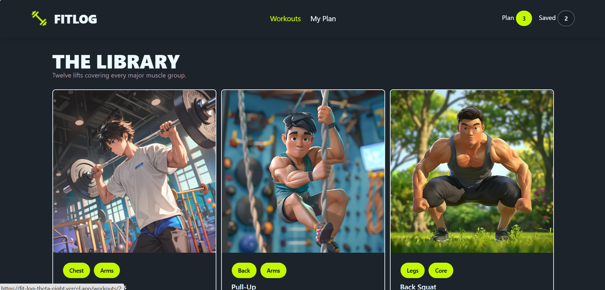

# 🏋️ FITLOG — Workout Management App

A modern workout management application that helps users explore exercises, view detailed workout information, and organize their daily and saved workout plans.

## 🔗 Live Demo

[**Visit FITLOG →**](https://fit-log-theta-eight.vercel.app/)

## 📸 Project Screenshot




## 📖 Project Overview

**FITLOG** is a workout management application designed to make workout planning simple and organized. Users can browse a collection of exercises, explore detailed workout information, add exercises to their daily workout plan, and save their favorite workouts for later.

The application also provides sorting options to help users find suitable exercises based on workout duration, calories burned, and ratings.

FITLOG offers a user-friendly interface that makes exploring and organizing workout routines convenient.

## ✨ Key Features

- **Workout Library:** Browse and explore a variety of exercises.
- **Exercise Details:** View workout duration, estimated calories burned, difficulty level, sets, reps, ratings, and instructions.
- **Today's Plan:** Add exercises to a daily workout plan and organize workout activities.
- **Saved Workouts:** Save favorite exercises for future reference.
- **Sorting Options:** Sort exercises by duration, calories burned, or rating.
- **Toast Notifications:** Receive instant feedback through notifications when performing supported actions.
- **Responsive UI:** Enjoy a clean interface designed for convenient browsing across different screen sizes.

## 🛠️ Technology Stack

The project is built using the following technologies:

- **Next.js** — React framework for building the application.
- **React** — Component-based user interface development.
- **TypeScript** — Type-safe JavaScript development.
- **Tailwind CSS** — Utility-first styling.
- **DaisyUI** — Prebuilt UI components built on Tailwind CSS.
- **React Icons** — Icon library for interface elements.
- **React Toastify** — Toast notifications for user feedback.

## 📦 Dependencies

The main dependencies used in this project include:

| Package | Purpose |
|---|---|
| `next` | Application framework |
| `react` | UI development |
| `react-dom` | Rendering React components |
| `typescript` | Type checking |
| `tailwindcss` | Styling |
| `daisyui` | UI components |
| `react-icons` | Icons |
| `react-toastify` | Toast notifications |


## 🚀 Installation & Setup

Follow these steps to run FITLOG on your local machine.

### Prerequisites

Make sure you have installed:

- [Node.js](https://nodejs.org/)
- npm (included with Node.js)
- Git

### 1. Clone the Repository

```bash
git clone <https://github.com/Wasima230Sultana/Fit-Log.git>
```

### 2. Navigate to the Project Directory

```bash
cd Fit-Log
```

### 3. Install Dependencies

```bash
npm install
```

### 4. Start the Development Server

```bash
npm run dev
```

### 5. Open the Application

Visit the following URL in your browser:

```text
http://localhost:3000
```

## 📁 Project Structure

A typical Next.js project structure may look like this:

```text
fitlog/
├── public/
│   └── fitlog-screenshot.png
├── src/
│   ├── app/
│   ├── components/
│   └── ...
├── package.json
├── package-lock.json
├── tsconfig.json
├── next.config.ts
└── README.md
```


## 🔗 Relevant Links

- **Live Demo:** [FITLOG](https://fit-log-theta-eight.vercel.app/)
- **GitHub Repository:** [https://github.com/Wasima230Sultana/Fit-Log]
- **Next.js Documentation:** https://nextjs.org/docs
- **Tailwind CSS Documentation:** https://tailwindcss.com/docs
- **DaisyUI Documentation:** https://daisyui.com/
- **React Icons:** https://react-icons.github.io/react-icons/
- **React Toastify:** https://fkhadra.github.io/react-toastify/

## 🎯 Project Goal

The goal of FITLOG is to provide a simple and convenient way to explore exercises, manage daily workout plans, and keep track of favorite workouts through an organized interface.

## 👩‍💻 Author

**Wasima Sultana**

- GitHub: [Wasima230Sultana](https://github.com/Wasima230Sultana)

---

⭐ If you find FITLOG useful, feel free to explore the live demo and check out the project!

